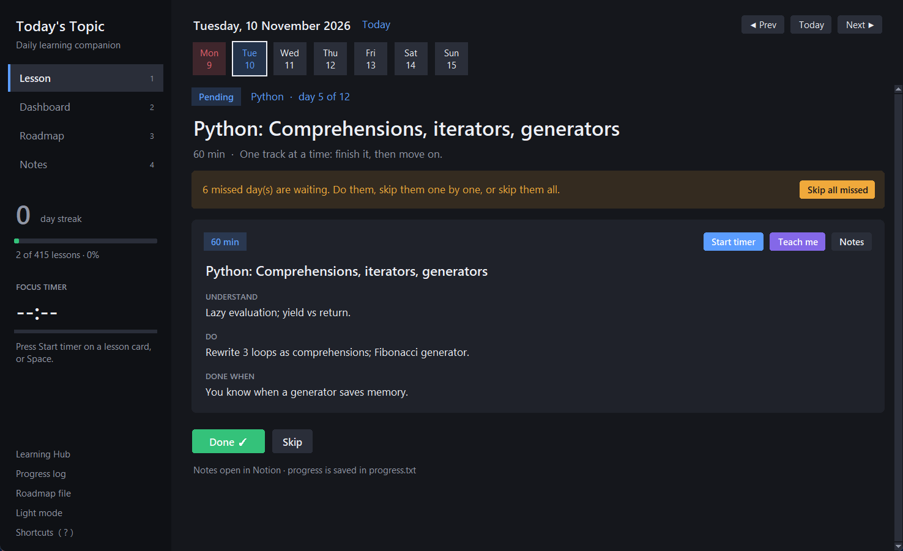
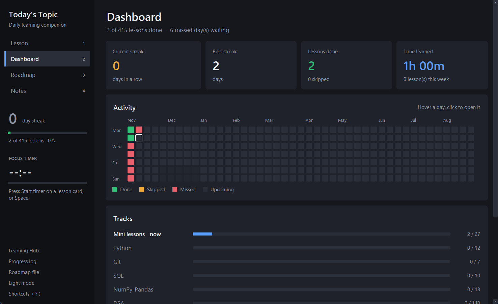
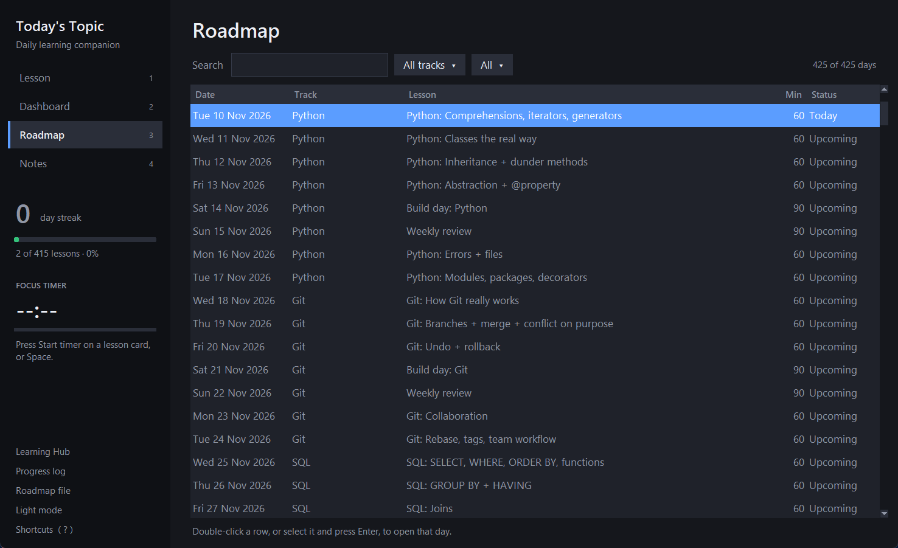
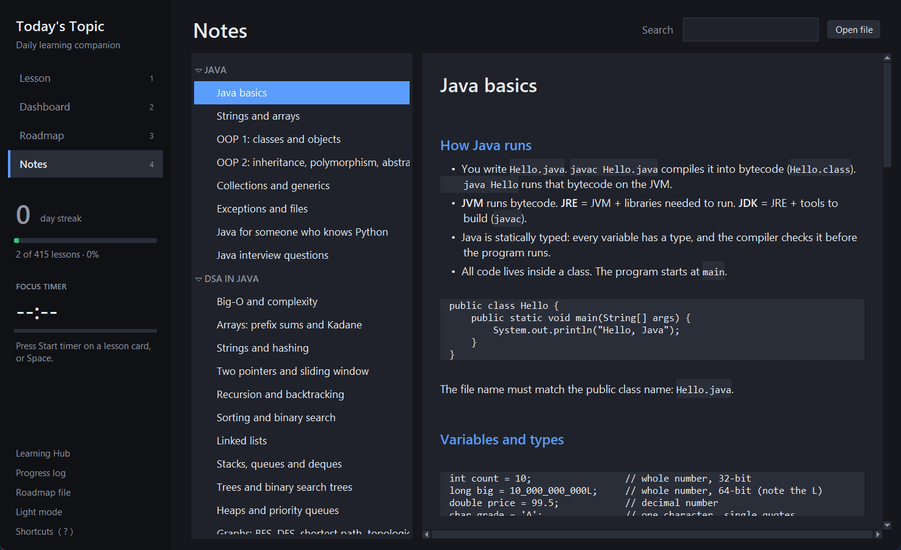

# Personal Study System

A desktop app that tells me what to study today, tracks whether I did it, and keeps my notes next to the plan. Built with Python and tkinter only, so there is nothing to install.



## What it does

- **Lesson**: shows today's topic as a card (what to understand, what to do, when it counts as done). Mark it Done or Skip; Undo is always possible. Missed days queue up instead of disappearing.
- **Focus timer**: start a countdown for the lesson's planned minutes. It keeps running while you move between views.
- **Dashboard**: current and best streak, time learned, an activity heatmap, progress per track, and upcoming dates from `my-events.txt`.
- **Roadmap**: every day of the plan in one searchable table, with filters for track and status.
- **Notes**: a built-in reader for Markdown notes, with search. Ships with notes on Java and on DSA in Java.
- Light and dark themes, and keyboard shortcuts for everything.

| Dashboard | Roadmap | Notes |
|---|---|---|
|  |  |  |

## The roadmap

One track at a time, one small lesson a day:

Python → Git → SQL → NumPy/Pandas → DSA → Machine Learning → Deep Learning → GenAI → Deployment

Weekdays are 60 minutes, weekends 90 (Saturday build day, Sunday review). Exam seasons switch to 30-minute mini lessons.

The plan lives in `build_roadmap.py`. Edit it and run it to regenerate `roadmap.json` and `roadmap.txt`. Regenerating never touches your progress.

## Notes included

**Java** (`notes/java`)

1. Java basics
2. Strings and arrays
3. OOP 1: classes and objects
4. OOP 2: inheritance, polymorphism, abstraction
5. Collections and generics
6. Exceptions and files
7. Java for someone who knows Python
8. Java interview questions

**DSA in Java** (`notes/dsa-java`)

1. Big-O and complexity
2. Arrays: prefix sums and Kadane
3. Strings and hashing
4. Two pointers and sliding window
5. Recursion and backtracking
6. Sorting and binary search
7. Linked lists
8. Stacks, queues and deques
9. Trees and binary search trees
10. Heaps and priority queues
11. Graphs: BFS, DFS, shortest path, topological sort
12. Greedy and dynamic programming

Every Java code block in the notes compiles, and the DSA functions were run against known answers.

## Adding notes

**From an AI chat (easiest):** copy the reply with the chat's copy button, open Notes and press **Paste note** (or `Ctrl+V`). The window then:

- removes chat lines such as "Sure, here is note 1" and "Say next for note 2"
- unwraps a reply that came inside one big code block, and closes a code block left open by a cut-off reply
- picks the title from the first `# ` line and guesses the subject from the text (change it if it's wrong, or type a new subject)
- shows exactly where it will save, for example `notes\python\03-logging.md`, and warns about anything odd
- saves a reply containing several notes as separate files, and asks before replacing a note with the same title

**By hand:** save a `.md` file into `notes/<subject>/`. The first line `# Title` becomes the note's name and a number prefix (`01-`, `02-`) sets the order. Files saved by Notepad as UTF-8, UTF-8 with BOM or ANSI, and `.txt` files, all work.

**Removing:** **Remove** moves the open note to `notes/_trash`, so nothing is ever deleted.

Folders starting with `_` are ignored. A file saved straight into `notes/` shows under "Unsorted".

## Run it

Needs Python 3.10 or newer on Windows.

```
python today.py
```

Use `pythonw today.py` to start it without a console window.

## Keyboard shortcuts

| Key | Action |
|---|---|
| `1` `2` `3` `4` | Lesson / Dashboard / Roadmap / Notes |
| `Left` `Right` | Previous / next day |
| `T` | Jump to today |
| `D` `S` `U` | Done / Skip / Undo |
| `L` | Teach me |
| `N` | Open the topic's notes page in Notion |
| `Space` | Start or pause the focus timer |
| `Ctrl+F` or `/` | Search the roadmap, or the notes when Notes is open |
| `?` | Show the shortcut list |

## Files

| File | Purpose |
|---|---|
| `today.py` | The app |
| `build_roadmap.py` | Source of the plan; generates `roadmap.json` and `roadmap.txt` |
| `roadmap.json` | The day-by-day plan the app reads |
| `my-events.txt` | Your own dates (exams, deadlines), one per line: `YYYY-MM-DD  name` |
| `notes/` | Markdown notes shown in the Notes view |
| `notion_links.json`, `notion_sync.py`, `notion_setup.py` | Optional Notion integration for per-topic notes pages |
| `progress.txt` | Created on first use; append-only log of Done / Skip / Undo (not committed) |

## Optional extras

- **Teach me** opens a terminal with an AI tutor session for the lesson. It needs the Claude Code CLI on your PATH; the rest of the app works without it.
- **Notion**: the Notes button on a lesson opens that topic's page in Notion using `notion_links.json`. Live progress sync needs a Notion token (see `notion_setup.py`).

## Author

Aditya Soni
